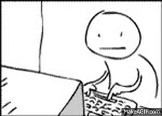

## Hi there, I'm Bilal 👋

**Advanced Computing (Honours)** - Machine Learning and Cyber Security

---

### 🛠️ Personal Projects

#### **See my Public Repo**

#### *Highlighted Projects*
* 🏅 **[Weblympics](https://github.com/bilalm-19/weblympics)** - Webcam-controlled sports game in the browser, inspired by Wii Sports: six sports played with your body against bots or friends, online, offline or over your wifi ([play](https://comp4020-final-bilalm004.fly.dev), deployed from my course account).
* 🔄 **[Delta Syncer](https://github.com/bilalm-19/delta-syncer)** - Efficient (delta) data synchronization tool.
* 🔋 **[Battery Buddy](https://github.com/bilalm-19/battery_buddy)** - Grid-scale battery trading simulator (including an AI powered decision maker).
* 🧱 **[Life2Craft](https://github.com/bilalm-19/life2craft)** - Turns a photo of an object (a tower, a building, a statue) into a Minecraft build you can paste in with WorldEdit or Litematica.
* 🎨 **[Colourise-Net](https://github.com/bilalm-19/colourise-net)** - PyTorch U-Net that colourises greyscale images, served through a FastAPI inference server with a web demo.
---

### 🤖 Agentic Coding Projects
*Select projects created for the Agentic Coding Studio course (built under my account for it [@BilalM004](https://github.com/BilalM004))*

* 🏅 **[Weblympics](https://comp4020-final-bilalm004.fly.dev)** - Webcam-controlled sports game (final project). The deployed version from my course account.
* 🚀 **[Time is Trippy](https://comp4020-agentic-coding-studio.github.io/comp4020-ass1-BilalM004/)** - A visual, interactive story created to explain the theory of special relativity.
* 🕸️ **[Web-Slinger Adventures](https://comp4020-agentic-coding-studio.github.io/comp4020-crit5-BilalM004/)** - Interactive web-based adventure game.
---

<!--
**bilalm-19/bilalm-19** is a ✨ _special_ ✨ repository because its `README.md` (this file) appears on your GitHub profile.

Here are some ideas to get you started:

- 🔭 I’m currently working on ...
- 🌱 I’m currently learning ...
- 👯 I’m looking to collaborate on ...
- 🤔 I’m looking for help with ...
- 💬 Ask me about ...
- 📫 How to reach me: ...
- 😄 Pronouns: ...
- ⚡ Fun fact: ...
-->
